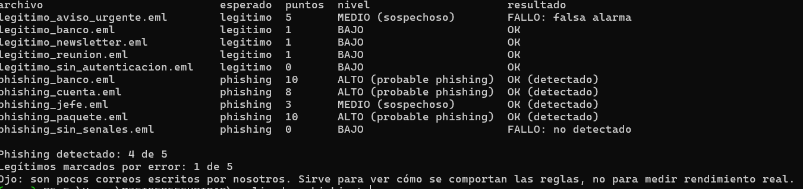

# Analizador de phishing con IA local

Herramienta en Python que automatiza el triaje inicial de correos sospechosos (`.eml`) en tres capas: **comprobaciones automáticas verificables con código**, una **puntuación de riesgo calculada con reglas** y un **informe redactado por un modelo de lenguaje local** (Llama 3.2 vía Ollama). Todo se ejecuta en local: ningún dato sale del equipo.

## Problema que resuelve

Los analistas de un SOC revisan a diario correos reportados por usuarios. Extraer cabeceras (SPF, DKIM, Return-Path), indicadores de compromiso y redactar el informe lleva tiempo. Este proyecto automatiza la extracción, calcula una puntuación y genera un primer borrador de análisis.

## Cómo funciona

```text
[.eml] -> [Parser Python] -> [Reglas y puntuación 0-10] -> [Llama 3.2: informe]
```

1. Lee el archivo `.eml` con la librería estándar `email` y extrae cabeceras, URLs e IPs.
2. **Las reglas puntúan cada señal** (tabla de abajo). El total se limita a 10: de 0 a 2, riesgo BAJO; de 3 a 5, MEDIO; de 6 a 10, ALTO.
3. El modelo recibe la puntuación y los hallazgos como datos, con la orden de **no inventar otra nota** y de **no recomendar nunca responder al remitente ni abrir enlaces**.

| Señal | Puntos |
|---|---|
| Reply-To con dominio distinto del remitente | 2 |
| Return-Path con dominio distinto del remitente | 1 |
| SPF falla (`fail` o `softfail`) | 3 |
| DKIM ausente o inválido | 2 |
| Dominio del remitente que imita a una marca conocida | 3 |
| Enlace con dirección IP en lugar de dominio | 3 |
| Enlace acortado | 1 |
| Lenguaje de urgencia: una palabra / dos o más | 1 / 2 |

## Resultado de ejemplo

Correo ficticio. La IP `203.0.113.45` está reservada para documentación y no corresponde a ningún servidor real.


## Evaluación de las reglas

`crear_muestras.py` genera 10 correos ficticios (5 legítimos y 5 de phishing) y `evaluar.py` pasa las reglas por todos. Se marca como sospechoso un correo con 3 puntos o más.

| Correo | Esperado | Puntos | Resultado |
|---|---|---|---|
| legitimo_aviso_urgente | legítimo | 5 | **falsa alarma** |
| legitimo_banco | legítimo | 1 | correcto |
| legitimo_newsletter | legítimo | 1 | correcto |
| legitimo_reunion | legítimo | 1 | correcto |
| legitimo_sin_autenticacion | legítimo | 0 | correcto |
| phishing_banco | phishing | 10 | detectado |
| phishing_cuenta | phishing | 8 | detectado |
| phishing_jefe | phishing | 3 | detectado (por poco) |
| phishing_paquete | phishing | 10 | detectado |
| phishing_sin_senales | phishing | 0 | **no detectado** |



**Resultado: 4 de 5 phishing detectados y 1 de 5 legítimos marcados por error.**

- **La falsa alarma** es un aviso real de una comunidad: tiene SPF en `softfail` y lenguaje de urgencia, igual que un fraude. Las reglas no distinguen el contexto.
- **El phishing no detectado** llega con la autenticación en regla y sin palabras de urgencia. Solo se delata por el contenido (un enlace a un `.zip` en un dominio desconocido), que las reglas no examinan.
- **`phishing_jefe` se detecta con solo 3 puntos** (Reply-To distinto más una palabra de urgencia). No reconoce lo más característico del fraude, la petición de tarjetas regalo.
- **El umbral:** con 3 puntos se detectan 4 de 5 phishing y se marca 1 legítimo; con 4 o 5, 3 de 5 y 1; con 6, 3 de 5 y 0. Es el mismo compromiso entre detección y falsas alarmas de cualquier detector. **No se ha retocado ninguna regla para estas muestras**, porque ajustarlas con las mismas preguntas del examen mejoraría la nota sin demostrar nada.

## Calidad observada del informe de la IA

Una ejecución con el correo de phishing de ejemplo:

- El informe **respeta la puntuación calculada** (10/10). Con versiones anteriores, en las que la puntuación la daba el modelo, el mismo correo recibió 9/10 y 6/10.
- **Ya no recomienda contactar al remitente**; recomienda no responder ni abrir los enlaces.
- **Sigue cometiendo errores:** afirmó que la IP "es conocida por ser utilizada en ataques de phishing", algo que no puede saber (es una dirección de documentación); incluyó una palabra en portugués; y esta vez no mencionó el Reply-To de Gmail, que sí aparece entre los hallazgos.

Por eso el informe de la IA es un **borrador que debe revisar una persona**.

## Cómo ejecutarlo (Windows)

Requisitos: Python 3, [Ollama](https://ollama.com) en marcha y el modelo descargado (`ollama pull llama3.2`).

```powershell
git clone https://github.com/m2ciber/analizador-phishing.git
cd analizador-phishing
python -m venv venv
.\venv\Scripts\Activate.ps1
python -m pip install -r requirements.txt
python analizador.py
```

Opciones:

- `python analizador.py --sin-ia` muestra solo las comprobaciones y la puntuación.
- `python analizador.py ruta\al\correo.eml` analiza otro correo.
- `python crear_muestras.py` y `python evaluar.py` regeneran y repiten la evaluación.

## Limitaciones

- Son **10 correos escritos por mí**, y yo también escribí las reglas. Sirven para ver cómo se comportan las reglas, no para medir rendimiento en correo real.
- La lista de palabras de urgencia está en español y la de marcas es pequeña (incluye una ficticia para las pruebas).
- Solo se analiza la parte de texto plano. Los correos solo en HTML se analizan mal.
- No se consulta la reputación de IPs ni de URLs.
- Un solo modelo (Llama 3.2) y una sola ejecución del informe.

## Próximos pasos

- Añadir reglas para señales no cubiertas (archivos comprimidos, peticiones de tarjetas regalo o transferencias) y **medirlas con correos nuevos**, no con los mismos.
- Probar con correos legítimos reales y anonimizados para medir las falsas alarmas.
- Detectar dominios parecidos a marcas con distancia de edición y homoglifos.
- Consultar VirusTotal o AbuseIPDB para la reputación de IPs y URLs.
- Comprobar automáticamente que el informe de la IA no afirma hechos que el programa no ha verificado.