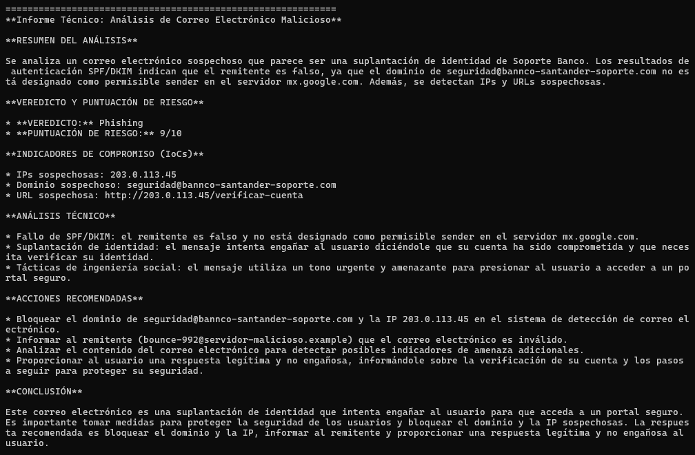

# Analizador de phishing con IA local

Herramienta en Python que automatiza el triaje inicial de correos sospechosos (`.eml`). Extrae cabeceras, URLs e IPs con expresiones regulares y pide a un modelo de lenguaje local (Llama 3.2 vía Ollama) un informe tipo SOC. Todo se ejecuta en local: ningún dato sale del equipo.

## Problema que resuelve

Los analistas de un SOC revisan a diario correos reportados por usuarios. Extraer cabeceras (SPF, DKIM, Return-Path), indicadores de compromiso y redactar el informe lleva tiempo. Este proyecto automatiza la extracción y genera un primer borrador de análisis.

## Cómo funciona

```text
[.eml] -> [Parser Python + regex] -> [Cabeceras, URLs, IPs] -> [Llama 3.2 en Ollama] -> [Informe]
```

1. Lee el archivo `.eml` con la librería estándar `email`.
2. Extrae From, Reply-To, Return-Path, resultados de autenticación, URLs e IPs.
3. Envía esos datos a Ollama con un prompt de analista SOC y muestra el informe.

## Evidencia de ejecución



El correo de `muestras/` es ficticio. La IP `203.0.113.45` está reservada para documentación y no corresponde a ningún servidor real.

## Cómo ejecutarlo (Windows)

Requisitos: Python 3, [Ollama](https://ollama.com) en marcha y el modelo descargado (`ollama pull llama3.2`).

```powershell
git clone https://github.com/m2ciber/analizador-phishing.git
cd analizador-phishing
python -m venv venv
.\venv\Scripts\Activate.ps1
python -m pip install -r requirements.txt
python analizador.py
```

## Limitaciones observadas

- El modelo local comete errores. En la prueba recomendó "informar al remitente", algo que no se debe hacer ante un phishing, y no destacó que el `Reply-To` (Gmail) no coincide con el remitente. El informe es un borrador que debe revisar una persona.
- Los correos solo en HTML, sin parte de texto plano, no se analizan bien.
- No hay comprobación de reputación de URLs e IPs.

## Próximos pasos

- Añadir comprobaciones automáticas de discrepancias (From frente a Reply-To) sin depender de la IA.
- Consultar VirusTotal o AbuseIPDB para la reputación de IPs y URLs.